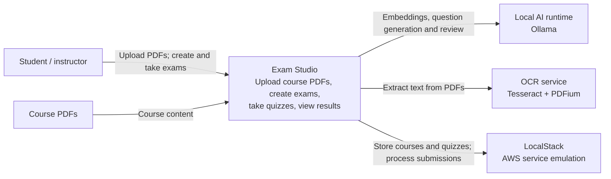
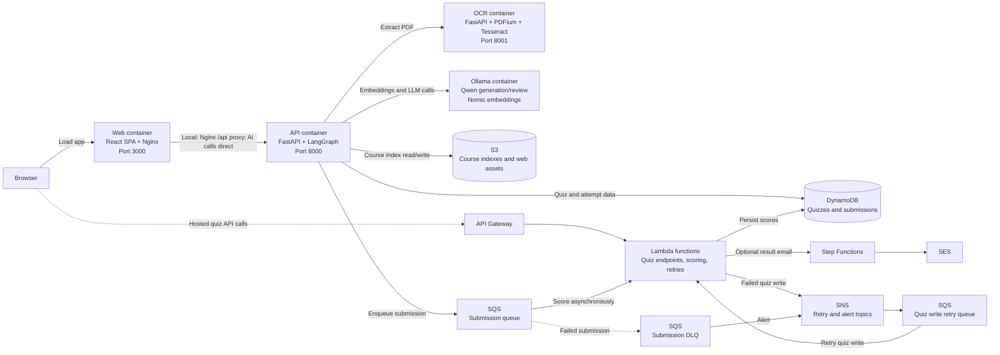
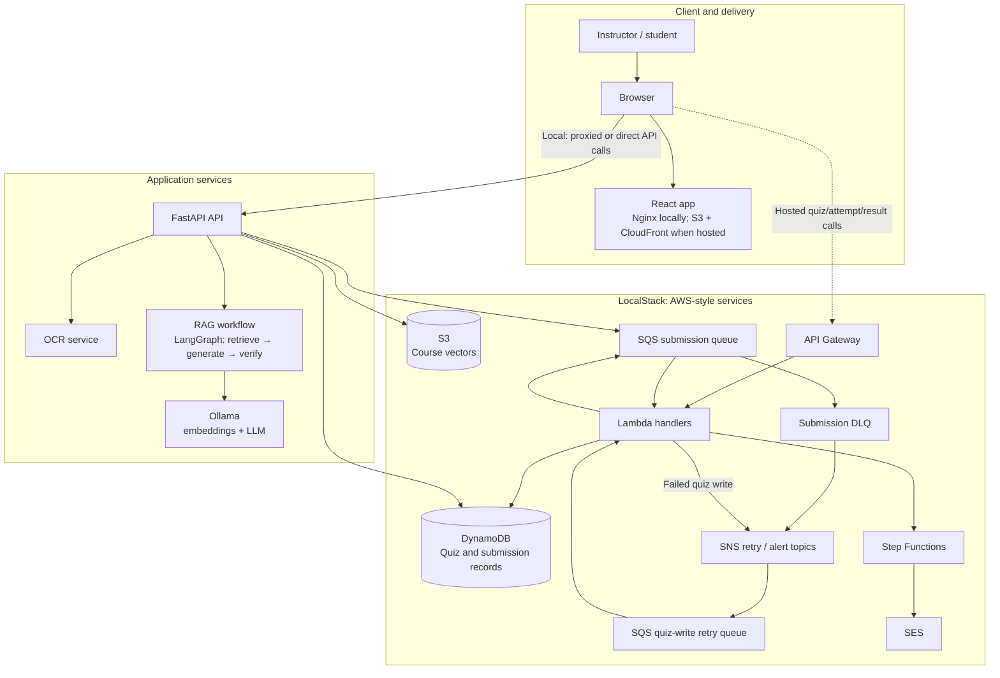
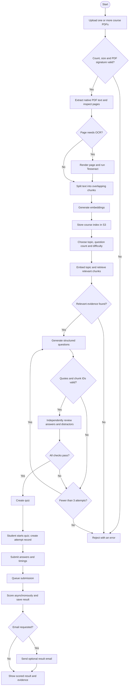

# Exam Studio

React + FastAPI exam simulator with local AI, PDF retrieval, LangGraph validation, and an AWS-style LocalStack backend.

## Run locally (Windows)

1. Start Docker Desktop in Linux-container mode. Allocate sufficient memory for the local model (at least 12 GB available is recommended for the default 7B model plus services).
2. Copy `.env.example` to `.env`. Set `LOCALSTACK_AUTH_TOKEN` to your own LocalStack token. The current LocalStack image requires an account token. EventBridge Pipes and CloudFront require a plan that includes those services; see [LocalStack licensing](https://docs.localstack.cloud/aws/licensing/).
3. From this folder run `./bin/deploy.ps1` in PowerShell. On Linux/macOS use `bash bin/deploy.sh`.
4. Open http://localhost:3000. Interactive API documentation: http://localhost:8000/docs.
5. Select or drag in up to **10 course PDFs** (20 MB each, 50 MB combined), enter a topic, and generate an exam. The supplied problem statement defines the software requirements; it is not automatically used as course content.

Initial setup downloads Docker images and approximately 5 GB of model weights. Model execution stays local through Ollama. Set `OLLAMA_MODEL` in `.env` to use another compatible structured-output model, and pull that model in Ollama. Generation on CPU can take several minutes.

The local React/Nginx container proxies `/api` to FastAPI. The deployment also publishes the built React app to the `webapp` S3 website bucket and provisions CloudFront. S3's `config.js` points quiz/attempt/submission/leaderboard calls to the emulated API Gateway; PDF ingestion and slow CPU AI generation use the local FastAPI service directly to avoid API Gateway timeouts and upload limits. Deployment addresses are recorded in `artifacts/deployment.json` after a successful deployment. LocalStack URLs are local emulation addresses, not public internet hosting.

## Application flow

- PDF ingestion: validate all PDF sizes/signatures before ingestion; combine the batch into one course index and retain filenames and per-file page numbers → detect page text quality and image coverage → keep readable native text or apply local OCR to scanned/image-heavy pages → split overlapping chunks with LangChain → embed using `nomic-embed-text` → persist vectors and page metadata in S3.
- Retrieval: embed the requested topic → cosine similarity search over that course's vectors → reject low-relevance retrieval.
- LangGraph: retrieve → generate structured MCQs → deterministic evidence checks → independent model correctness review → regenerate up to three times → publish or reject. There is no fallback to fabricated questions.
- Students see only question text/options before submission. Correct answers, evidence, explanations, and page references are returned in scored results.
- Attempts begin with a server timestamp. The client tracks time spent on each question. A timed quiz has a total budget of `question_count × timer`; expired attempts score zero. Correct responses earn `100 × max(0, 1 − seconds_spent / timer)`; wrong/unanswered responses earn zero. Untimed correct responses earn 100. The final score is the average across all questions.
- Submit → SQS → scoring Lambda → DynamoDB. The UI polls until scoring completes. A sparse QuizID/Score GSI supplies leaderboard results. SQS redelivery is safe for scoring writes and Step Functions executions.
- Optional email → Step Functions choice → SES HTML email, with a failure state. LocalStack simulates SES delivery; real inbox delivery is not asserted.
- Failed quiz writes → SNS → retry SQS → retry Lambda. Submission failures → DLQ (maxReceiveCount 1) → EventBridge Pipe → alarm SNS topic. Set `ALERT_EMAIL` for an email subscription and confirm it when the environment requires it.

## Technology stack

| Area | Technologies |
|---|---|
| Frontend | React 19, JavaScript (ES modules), Vite 6, lucide-react, CSS |
| Web serving | Nginx; S3 website hosting and CloudFront are provisioned for the hosted-style deployment |
| API | Python 3.12, FastAPI, Uvicorn, Pydantic; Mangum adapts FastAPI routes for AWS Lambda |
| PDF processing | pypdf and PDFium |
| OCR | Tesseract 5 and Pillow, exposed through a separate FastAPI service |
| Retrieval and orchestration | LangChain text splitters and Ollama integrations, LangGraph, cosine-similarity retrieval |
| Local AI | Ollama; `qwen2.5:7b` for question generation/review and `nomic-embed-text` for embeddings by default |
| Persistence and messaging | boto3 with S3 and DynamoDB; SQS, SNS, Lambda, Step Functions, SES, and EventBridge Pipes |
| Local infrastructure | Docker Compose and LocalStack for AWS service emulation |
| Testing | pytest; requests for integration tests |

## Key implementation files

| Component | Location |
|---|---|
| React interface | `frontend/src/main.jsx`, `frontend/src/style.css` |
| FastAPI routes | `backend/app/main.py` |
| OCR service (Tesseract + PDFium) | `ocr/app.py`, `ocr/Dockerfile` |
| PDF/RAG/LangGraph workflow | `backend/app/rag.py` |
| AWS persistence and scoring | `backend/app/store.py` |
| Eight Lambda entry points | `backend/app/handlers.py` |
| AWS CLI provisioning | `bin/provision.py` (invoked by `bin/deploy.sh` / `.ps1`) |
| Containers | `docker-compose.yml` |

The provisioner creates the two specified DynamoDB tables, eight separately scoped Lambda IAM roles, SQS queues and redrive policy, SNS topics/subscriptions, an EventBridge Pipe, SES identity, email state machine and role, API Gateway REST resources/CORS/prod stage, S3 buckets, and CloudFront. The statement says six endpoints but enumerates seven HTTP functions; all seven are implemented, plus PDF ingestion and attempt creation extensions.

All newly created quizzes use AI-generated, validated questions. No fixed question bank is silently seeded. The disconnected homepage has explicitly marked visual examples; they route to exam creation. Integration fixtures are isolated test data and are removed by the tests.

## Architecture diagrams

The diagrams below describe the current local-first application. LocalStack emulates AWS APIs for development; those endpoints are not public AWS hosting. The hosted-style deployment routes quiz operations through its emulated API Gateway, while PDF ingestion and slow AI generation use the local FastAPI service directly.

### C4 Level 1 — System Context



### C4 Level 2 — Containers



### Application architecture



### Main application flow



## Code review notes

This is a focused source review of the retrieval/generation module and related API/storage flows, not a full security audit or a runtime test.

| Severity | Finding | Recommendation |
|---|---|---|
| Medium | The submission lookup endpoint has no authentication or ownership check. Anyone who obtains a `submission_id` can retrieve the scored submission, including the participant's name, answers, correct answers, and explanations. See [`backend/app/main.py`](backend/app/main.py) and [`backend/app/store.py`](backend/app/store.py). | Require authentication and verify that the caller owns the attempt, or use a short-lived, scoped result token. |
| Informational | Question grounding fails closed on validation errors, but the independent correctness check uses the same local model as generation. Correlated model errors can still pass review. | For higher-stakes use, add deterministic/domain-specific checks or an independently sourced reviewer. |

No other clear blocking correctness issue was identified in the reviewed RAG flow. The application is intended for local learning use; it currently has no authentication or exam proctoring. Do not expose it to untrusted users or use it for high-stakes exams without addressing the authorization and timing limitations described below.

## Verification

```powershell
cd frontend
npm ci
npm run build
cd ..
docker compose run --rm --no-deps -v "${PWD}:/workspace" -w /workspace/backend api python -m pytest tests/test_guardrails.py -q
docker compose run --rm --no-deps -e RUN_INTEGRATION=1 -e API_URL=http://api:8000 -v "${PWD}:/workspace" -w /workspace/backend api python -m pytest tests/test_integration.py -q
docker compose run --rm --no-deps -e LIVE_MODEL_TESTS=1 -v "${PWD}:/workspace" -w /workspace/backend api python -m pytest tests/test_live_model.py -q
```

To test actual AI creation as well, add `-e TEST_COURSE_ID=<uploaded course id> -e TEST_TOPIC=<course topic>` to the integration command. Model tests require pulled models and readable course content. Tests do not equate a mocked model with real generation.

## Limits and operating notes

Guardrails reduce hallucinations, not eliminate them: an exact quote can exist while a model still misinterprets it. The independent review uses a separate call to the same local model, so correlated errors are possible. Results expose source evidence for review. PDFs are untrusted data; prompts tell models never to follow instructions inside them. Scanned and image-heavy pages are detected automatically and processed by the local OCR container during upload. Recognition is heuristic and imperfect; review low-confidence warnings and cited source material. Retrieval currently loads a per-course JSON vector index into memory and is intended for small course libraries (20 MB and 300 pages per PDF, up to 10 PDFs / 50 MB combined per upload), not large-scale multi-tenant use.

This is a local learning application without authentication or exam proctoring. Private quizzes are omitted from public discovery and accessed by unguessable code; they are not user-authorized records. Browser question timings are not tamper-proof. Restrict the local ports to trusted users; add authentication, rate limits, storage quotas and stronger per-question server timing before a public or high-stakes deployment. API Gateway/Lambda synchronous AI generation may exceed gateway timeouts for large requests; use the local API path for CPU generation. A production deployment should put AI generation into a separate asynchronous job queue.

Stop services with `docker compose stop`. Keep `.env` out of version control. Do not run `docker compose down -v` unless you intend to delete locally downloaded model volumes.

## Current verification record

- React production build: passed.
- Docker API and UI builds: passed.
- Guardrail/scoring and multi-file ingestion tests: 7 passed. Multi-file tests verify combined ingestion, per-document citations, invalid batch rejection and single-file compatibility.
- Real Ollama embeddings + LangGraph question generation/review: 1 passed (82 seconds), using an isolated test excerpt and real models. Retrieval storage was replaced with the test excerpt in this check.
- Live API: health reports the model connected and database unavailable; invalid inputs return 422; unavailable storage returns a descriptive 503.
- Browser: homepage and exam creation form rendered and checked.
- Both local models installed (`nomic-embed-text`, `qwen2.5:7b`).
- Full infrastructure and PDF-upload-to-results cycle: blocked by missing LocalStack account activation. Do not treat the homepage or isolated AI test as evidence that these integrations work.


## Automatic OCR

The separate `ocr` Docker service runs Tesseract 5 and PDFium. The API sends each uploaded PDF to its `/extract` endpoint. Every page is checked for readable native text, replacement characters, and image coverage; pages with missing/unusable text or at least 35% image coverage are rendered for OCR. Ordinary text pages avoid OCR. Mixed PDFs retain original page numbers, filenames, extraction method and OCR confidence in the retrieval index.

Rendering is capped at 16 million pixels per page. Tesseract uses automatic layout/orientation detection, discards words below 40 confidence, and requires an average accepted-word confidence of 60 before using OCR text. Pages with no reliable text are excluded with visible warnings; a document with no usable course text is rejected. Blank pages are skipped. OCR is recognition, not a factual verifier: confidently misrecognized words can still occur, particularly with handwriting, equations, low-resolution scans or complex layouts.

Start/update OCR and the application independently of LocalStack activation:

```powershell
docker compose up -d --build --no-deps ocr api web
```

Health: http://localhost:8001/health (bound to loopback). API `/health` reports OCR connectivity as well. English is the default. English and Hindi language packs are installed; set `OCR_LANGUAGES=eng+hin` in `.env` and recreate OCR for mixed-language scans. Native PDF text is extracted in its original language.

A page has a 45-second OCR timeout, and a document has a 240-second processing budget checked between pages. Oversized, encrypted, invalid, and unreadable documents receive explicit errors. OCR service failures stop indexing instead of silently omitting pages. The service runs as an unprivileged user, serializes PDFium access, and has container CPU/memory limits. Temporary page images are removed after each OCR call.

Verification for this update: 4 real OCR tests passed (including native-text bypass, scanned/mixed PDFs, detection and invalid/blank/encrypted files); 9 backend/upload/guardrail checks passed, including actual multi-file upload → running OCR service → real Ollama embeddings, with only S3 persistence mocked because LocalStack remains unactivated. React production build passed. The deployed OCR service reports healthy and API health reports OCR connected.

```powershell
docker compose run --rm --no-deps -v "${PWD}/ocr:/workspace" -w /workspace ocr python -m pytest tests/test_extraction.py -q -p no:cacheprovider
```

Synthetic OCR test PDFs are in the ignored `artifacts/` directory. They are not automatically added to course material. Full PDF-upload persistence and the exam scoring infrastructure still require the existing LocalStack token setup.
